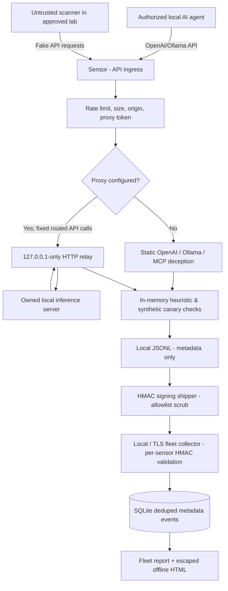

# Architecture — v0.3.0

## Three explicit trust boundaries

1. **Agent → sensor:** untrusted HTTP payload; auth token is required for every proxied model route. Fixed API allowlist; no dynamic URL selection. MCP decoy routes are not relayed.
2. **Sensor → approved inference:** outbound request is constructed from a new header set (not a copy). Only `127.0.0.1` TCP IPv4 endpoint, configured at server startup. No redirects followed. Caller Authorization, cookie, X-Proxy-Token, lab case or source IP are not forwarded. Request body is forwarded unmodified to enable realistic *authorized* agent tasks. Upstream responses are copied to client without being logged. Request timeouts, response byte ceiling and media-type constraints apply. Actual upstream is operator-controlled.
3. **Sensor → central collector:** metadata-only fields, sanitized by a **second** allowlist, signed using sensor-specific HMAC. Remote collection requires TLS on the receiver and certificate-validated HTTPS on the sender. Receiver does not expose commands, dashboards, model endpoints, or raw telemetry. Authenticated events are deduplicated transactionally in SQLite. Offline central reporting reads exported sanitized data.

## Data flow and persistence

- `sensor.events.jsonl`: one event per inbound API operation and a second `proxy_outcome` event per attempted relay, correlated through `parent_event_id`. Events are pseudonymous and may include lab canary ID/kind, never marker string by default.
- `collector.events.sqlite3`: `sensor_id + event_id` unique key; automatically discards unknown metadata keys. The storage cap is a maximum **record count**, not time retention or a cryptographic tamper-proof archive.
- `fleet-report`: groups by originating sensor, then by `(sensor_id, session_id)`, avoiding accidental cross-sensor merging of local HMAC pseudonyms. The central collector cannot reconstruct shared identities across sensors, by design.
- `fleet-dashboard`: offline-only sanitized HTML, escaped text with a restrictive CSP; no JavaScript or external assets.

## Modes

| Mode | Inference | Intended use | Risk |
|---|---|---|---|
| Decoy (default) | Static, never calls external model | Passive deception, calibration | Low in controlled local lab |
| Local model proxy (opt-in) | Relays fixed API routes to 127.0.0.1 | Authorised agent behavior across several turns | Agent data intentionally reaches local model |
| Central collection (separate process) | No inference | Ingest metadata from multiple signed sensors | Requires securing signing keys, DB, transport |

**Not provided:** a transparent network-layer interception proxy, dynamic browser interaction, a complete OpenAI/MCP clone, deep-sequence ML, a real-time multi-tenant SOC interface, or remote control of sensors. "Local model relay" is an application-layer proxy configured explicitly by the owner, not stealth interception.

## Important interpretive nuance

A system prompt in a request to an intended/approved inference server is normal LLM API behavior. A *trust-policy violation* requires evidence that the agent sent protected context **to a disallowed endpoint**, for example because an endpoint trust policy was bypassed, not because the network sensor observed a prompt. Synthetic marker matches prove exact marked text crossed the measured interface. Heuristic indicators do not prove intent or compromise.
