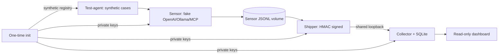

# Docker Compose Full Lab — quick start

**Scope:** local research sandbox, synthetic data only. The `test-agent` is a repeatable scripted client, **not** an autonomous adversarial agent or real LLM. No real secrets, outside inference provider, external scanner or exploitation is used.

## Prerequisites

- Docker Desktop with Compose v2, or Docker Engine + Compose plugin (Linux).
- Free localhost TCP ports `18080` and `18081`.
- A local checkout of this repo with `compose.full-lab.yaml` (branch containing Full Lab PR).

## One command

From the repository root:

```bash
docker compose -f compose.full-lab.yaml up --build -d
```

An **ephemeral privileged initializer** creates persistent random secrets and synthetic canary registry in private Docker named volumes. The initializer has the narrowly scoped `CHOWN`, `FOWNER`, and `DAC_OVERRIDE` capabilities to manage private named-volume ownership and permissions. It has no network access, runs only once, does not write secrets to your repo, and never echoes key values. The remaining services run as non-root UID 10001 with dropped capabilities and read-only container roots. Sensor and dashboard additionally join a host-facing bridge for localhost-only port publication.

The lab runs these five long-lived services: `sensor`, `collector`, `shipper`, `dashboard`, `test-agent`. A completed one-time `init` container also appears in Compose. The test-agent begins running eight synthetic requests every 45 seconds once the sensor is healthy. It does not require model weights, an API key, or LM Studio.

Open:

- **Web dashboard:** <http://127.0.0.1:18081>
- **Sensor health:** <http://127.0.0.1:18080/healthz>
- **Dashboard JSON:** <http://127.0.0.1:18081/api/summary>

Allow a short startup interval for the first shipper batch to reach the collector. Dashboard refreshes every 10 seconds.

## Verify / troubleshoot

```bash
docker compose -f compose.full-lab.yaml ps
docker compose -f compose.full-lab.yaml logs --tail=40 test-agent
docker compose -f compose.full-lab.yaml exec collector python -m deceptionsensor fleet-report --database /fleet/events.sqlite3
curl -fsS http://127.0.0.1:18081/api/summary
```

Expect nonzero `total_events` after the first test-agent cycle and shipper iteration. Requests with synthetic canaries are **intentional** and do not prove data exfiltration.

Manual one-off test-agent cycle:

```bash
docker compose -f compose.full-lab.yaml exec test-agent python -m deceptionsensor.full_lab test-agent --once
```

## Stop and reset

Stop while retaining evidence and secrets:

```bash
docker compose -f compose.full-lab.yaml down
```

**Destructive cleanup (deletes all data, synthetic registry and signing keys)** — do this only when you deliberately want a fresh isolated lab:

```bash
docker compose -f compose.full-lab.yaml down --volumes
```

Changing the Compose project name changes the named volume namespace and effectively starts a fresh lab. Secrets persist across normal restarts. Never commit Docker volumes or extracted private registry content.

## Architecture and security



- Ports bound **only** to `127.0.0.1` on the host: sensor `18080`, dashboard `18081`. No collector port is published.
- The private `internal: true` bridge isolates the collector, shipper and test-agent. Sensor and dashboard also attach to a **separate, non-internal host-facing bridge** so Docker can publish their localhost ports. That frontend bridge may permit egress: **Docker networking alone does not guarantee no outbound network access**. Enforce egress denial with host-level firewalls for higher-assurance deployments. Application code in this stack does not call external inference APIs.
- Collector listens only on its internal `127.0.0.1:18888`. Shipper shares its network namespace for loopback transport; HMAC authenticates telemetry. No remote collection is enabled.
- Dashboard shows sanitized, **bounded** metadata only. HTML is escaped, with no external resources or scripts, and explicitly labels synthetic detections. This is a local, read-only viewer, not a full SOC platform.
- `CAPTURE_MODE=metadata`. Response bodies, real prompts and raw canary marker strings are not saved. The test-agent reads the synthetic registry but has **no access to collector or sensor signing secrets**.
- Inference proxy is intentionally **disabled** for this stack. For experiments with LM Studio/Ollama, use the native sensor + local model workflow described in README; a Docker-to-host proxy requires separate, reviewed trust boundaries.

## Limitations and validation

- Current Full Lab tests run locally using Python's standard library, with a loopback integration harness. Docker builds and Compose networking require separate verification on a Docker-equipped host or CI. Do not treat code review as proof that Docker networking works in every Docker Desktop environment.
- `ship --follow` retries after process restart and the collector deduplicates; rotated source logs can be lost before shipping during long outages. No durable shipper queue, per-sensor mTLS, RBAC, forensic notarization or production-grade retention exists yet.
- Only the latest 2,000 collected events are reflected in dashboard breakdowns; total event count is an all-record count. This is not a globally distributed MadPot installation.
